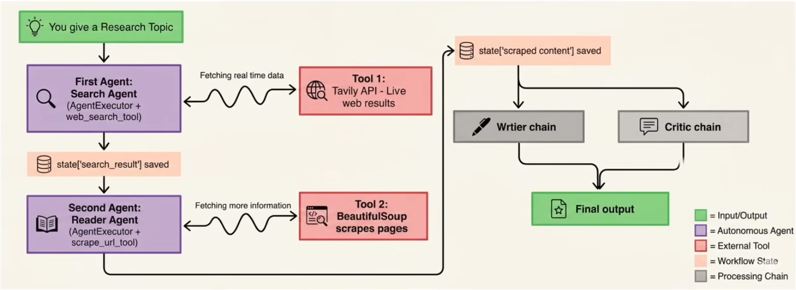
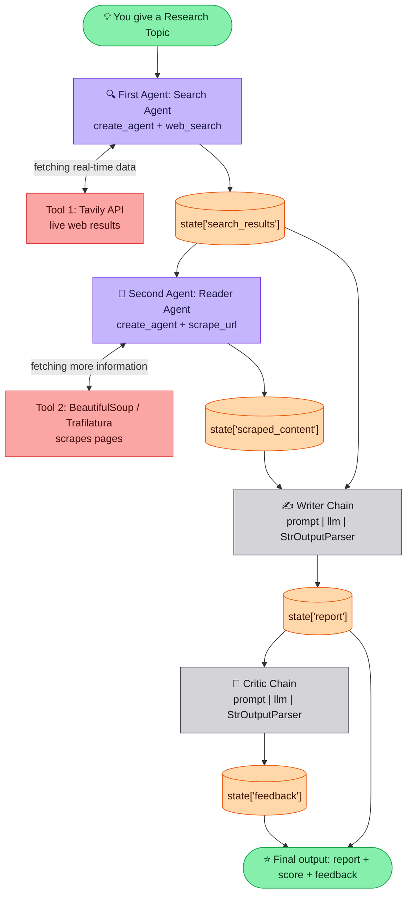

# Multi-Agent System Using LangChain

> Markdown version of [demo.excalidraw](demo.excalidraw).

## Overview

The **Multi-Agent Research Assistant** is a fully autonomous AI system that thinks, searches, reads and writes on its own. Instead of a single AI answering your question from tools, it deploys a **team of specialized agents** that collaborate to produce a professional research report on any topic you give them.

| Agent | Role |
|-------|------|
| 🔍 **Search Agent** | Goes out on the live internet and finds the most relevant and recent sources |
| 📖 **Reader Agent** | Dives deep into those sources, scraping and extracting meaningful content |
| ✍️ **Writer Chain** | Takes all the gathered information and writes a well-structured, detailed report |
| 🧐 **Critic Chain** | Reviews the report, scores it and gives feedback, like a senior researcher reviewing a junior's work |

Every agent is powered by a Large Language Model, connected through LangChain's modern **LCEL** pipeline, and coordinated through a shared `state` dictionary so they work as one unified system.

## Architecture



The same flow as a Mermaid diagram:



**Legend**

| Colour | Meaning |
|--------|---------|
| 🟩 Green | Input / Output |
| 🟪 Purple | Autonomous Agent (decides which tool to call) |
| 🟥 Red | External Tool |
| 🟧 Orange | Workflow State |
| ⬜ Grey | Processing Chain (fixed LCEL steps) |

> **Note:** The original drawing labels the agents "AgentExecutor" and draws the Writer and Critic side by side. In the actual code ([src/agents/agents.py](src/agents/agents.py), [src/pipelines/pipeline.py](src/pipelines/pipeline.py)) the agents are built with `create_agent`, and the steps run **in sequence**: the Writer uses both search results and scraped content, then the Critic reviews the Writer's report. The Mermaid diagram above shows the code's real flow.

## Data flow through `state`

| Step | Component | Reads | Writes |
|------|-----------|-------|--------|
| 1 | Search Agent | `topic` | `state['search_results']` |
| 2 | Reader Agent | `topic`, first 800 chars of `search_results` | `state['scraped_content']` |
| 3 | Writer Chain | `topic`, `search_results` + `scraped_content` | `state['report']` |
| 4 | Critic Chain | `report` | `state['feedback']` |

## Build steps

1. **Environment setup & folder structure**: create the venv, install `requirements.txt`, add `.env` keys, and create `src/tools`, `src/agents`, `src/pipelines`
2. **Create tools**: `web_search` (Tavily) and `scrape_url` (requests + BeautifulSoup / Readability / Trafilatura) in [src/tools/tools.py](src/tools/tools.py)
3. **Create agents**: Search and Reader agents with `create_agent`, Writer and Critic as LCEL chains in [src/agents/agents.py](src/agents/agents.py)
4. **Create pipeline**: `run_research_pipeline(topic)` chains all four steps through `state` in [src/pipelines/pipeline.py](src/pipelines/pipeline.py)
5. **Run & test**: `streamlit run app.py` (UI) or `python main.py` (CLI)

## Side note: `create_agent` vs `create_react_agent`

The drawing also includes a screenshot asking whether these two are the same. **They are not:**

| | `create_agent` | `create_react_agent` |
|---|---|---|
| Package | `langchain.agents` (LangChain 1.x) | `langgraph.prebuilt` / older `langchain` |
| Status | ✅ Modern, recommended | ⚠️ Older implementation, deprecated in favour of `create_agent` |
| How it works | Built-in tool-calling loop with a flexible **middleware** system | Based strictly on the original ReAct (Reason + Act) prompting pattern |

This project uses `create_agent`:

```python
from langchain.agents import create_agent

search_agent = create_agent(model=llm, tools=[web_search])
```

See the official [LangChain v1 migration guide](https://docs.langchain.com/oss/python/migrate/langchain-v1) for details.
