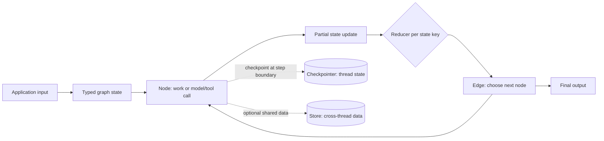
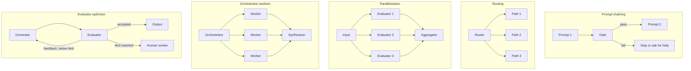
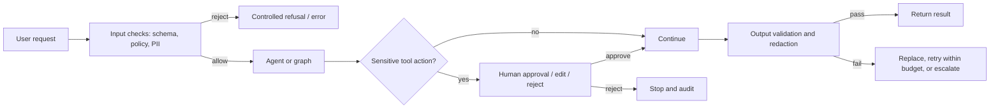

# LangGraph Workflows, State, Reducers and Guardrails

## Learning Objectives

By the end of this guide, you will be able to:

- Explain when a graph-based workflow is a better fit than a linear chain or a high-level agent.
- Design state, nodes, reducers, fixed edges, conditional routes, loops, and parallel fan-out/fan-in.
- Build and test a bounded essay-review workflow with deterministic example evaluators.
- Select and layer input, output, PII, and human-approval guardrails without treating them as perfect security boundaries.
- Make workflows observable, resumable, testable, and suitable for production constraints.

## Scope and Source Notes

The screenshots introduce LangGraph as an orchestration framework and show common LLM workflow patterns, graph vocabulary, a parallel essay evaluator, state/reducer concepts, and input/output guardrails. The related diagrams in this repository add sequential workflows, persistence, human-in-the-loop (HITL), subgraphs, and streaming. Those concepts are included where they complete the learning path.

**Screenshot-derived material:** workflow patterns (prompt chaining, routing, parallelization, orchestrator-workers, evaluator-optimizer); the nodes/edges mental model; essay topic, submission, parallel evaluation, aggregation, threshold routing, feedback, and revision loop; state fields such as `essay_text`, `topic`, dimension scores, `total_score`, `feedback`, and `evaluation_round`; and guardrails around the model that can filter input/output or allow processing. The `403` and `200 OK` labels are example application responses, not LangGraph-defined status codes.

**Research additions:** current Graph API semantics, super-steps, fan-in, `Send`, typed state and reducers, persistence versus stores, safe interrupt behavior, current LangChain guardrail middleware, version caveats, operational controls, alternatives, testing, and production guidance. These additions are based on the official documentation linked in [References](#references-and-further-learning).

## Overview

LangGraph is a runtime and API for expressing stateful application logic as a directed graph. A graph may contain deterministic code, model calls, tools, human decisions, or subgraphs. A node performs work; an edge decides what runs next; shared state carries the data between nodes. Unlike a simple chain, a graph can branch, fan out, wait for multiple results, loop, pause, and resume.

Use the Graph API when you need explicit control flow, custom state, parallel branches, durable execution, or a human approval point. A graph does not make an application intelligent by itself: model quality, tool design, policy, and data quality remain application responsibilities.



**How to read it:** input initializes state; nodes read state and return partial updates; reducers apply updates per key; edges schedule subsequent work; a checkpointer records snapshots for a thread; and a store is for application-defined information shared beyond one thread. The diagram is useful when deciding whether information belongs in per-run state, persisted conversation state, or durable user memory.

## Prerequisites

- Basic Python functions, type hints, `TypedDict`, lists, and dictionaries.
- Basic LLM concepts: prompts, model output variability, tool calls, and structured output.
- Familiarity with asynchronous services and external API failure is helpful for production topics.

## Learning Progression

### Level 1 - Fundamentals

**Objectives:** distinguish nodes/state/edges; compile and invoke a graph; explain overwrite versus reducer behavior; recognize sequential, branch, and loop workflows.

**Checkpoint:** draw a three-node graph and name the state keys each node reads and writes. You should be able to implement a pure function node and a conditional edge without an LLM.

### Level 2 - Intermediate

**Objectives:** implement parallel evaluation and a barrier-style fan-in; use conditional routing and bounded revision; add persistence and a human pause; compare a custom graph with `create_agent` middleware.

**Checkpoint:** run the example below, force both the approved and revision paths, and inspect the resulting state.

### Level 3 - Advanced

**Objectives:** choose graph versus Functional API; design state migrations, retries, idempotent side effects, PII handling, tool authorization, tracing, and cost limits; reason about fan-out throughput and partial failures.

**Checkpoint:** document a production workflow's failure paths, data retention, approval policy, budget limits, and tests before deploying it.

## Core Concepts and Terminology

| Term | Meaning |
| --- | --- |
| State | Shared, typed snapshot of values used by graph nodes. |
| Channel | A named state key with a value and an update rule. |
| Node | A function, runnable, or graph that reads inputs and returns an update. |
| Edge | A transition that schedules one or more downstream nodes. |
| Conditional edge | A router that selects destination node(s) from current state. |
| Reducer | Per-key function that combines the previous state value and a node update. |
| Super-step | One execution tick; nodes scheduled together run in parallel in that step. |
| Checkpointer | Persistence layer for graph snapshots, usually scoped by `thread_id`. |
| Store | Key-value persistence for application data shared across threads. |
| Interrupt | Dynamic pause that returns a payload to the caller and resumes with external input. |
| `Send` | Dynamic invocation of a node with a custom input, useful for map/reduce workers. |
| Middleware | Agent hook around model/tool/agent execution; often the simplest place for standard guardrails. |

### State and Reducers

A state schema is commonly a `TypedDict`. Nodes usually return **partial updates**, not a rebuilt copy of the complete state. Without a custom reducer, an update replaces the previous value for that key. A reducer attached with `Annotated` determines how updates combine. Use `add_messages` for message history that must support message-ID updates; plain list concatenation only appends.

For concurrent nodes that write to the same key, define a reducer whose semantics match the data. A list append reducer is useful for independent findings. Do not rely on an accidental order of parallel results if order has business meaning; attach stable identifiers and sort or reconstruct order explicitly. Avoid mutating nested objects in place: return updates so state transitions remain inspectable.

```python
import operator
from typing import Annotated
from typing_extensions import TypedDict


class State(TypedDict):
    status: str                         # last update replaces the old value
    findings: Annotated[list[str], operator.add]  # updates append
```

If the key must be cleared or replaced despite a merging reducer, consult the current `Overwrite` API. A reducer is not automatically a safe merge: decide duplicate handling, conflict policy, and reset behavior explicitly.

### Nodes, Edges, and Execution

`START` is the virtual entry point and `END` a terminal destination. A normal edge always schedules a known node. A conditional edge returns a destination name, `END`, a list of destinations, or `Send` objects. A node can call an LLM, perform deterministic validation, access a tool, or delegate to another graph. `compile()` constructs the runnable graph and is where checkpointers and other runtime options are attached.

LangGraph executes in super-steps. Nodes scheduled in the same step form parallel work; later steps observe their updates. If several branches must all finish before aggregation, express an explicit join such as `add_edge(["evaluate_a", "evaluate_b"], "aggregate")`. Do not assume that merely drawing several arrows into a node always communicates the intended barrier; make the dependency explicit and test it.

Use a conditional edge when routing alone is needed. Use `Command(update=..., goto=...)` when one node must both update state and choose its next destination. Avoid combining a dynamic route and a static outgoing edge from the same node unless both paths are intentionally meant to run.

## Common LLM Workflow Patterns

The patterns in the screenshots are composable shapes, not mutually exclusive architectures:

| Pattern | Shape | Good fit | Main trade-off |
| --- | --- | --- | --- |
| Prompt chaining / sequential | A -> B -> C | Each step depends on the previous output; validation gates can stop early. | Latency accumulates across calls. |
| Routing | Classifier/router -> one selected path | Different request types need different prompts, models, or policies. | Router errors can send work down the wrong path. |
| Parallelization | Input -> independent branches -> join | Independent evaluations, searches, or extractions. | Costs and provider load add up; results need a merge policy. |
| Orchestrator-workers | Planner -> dynamically selected workers -> synthesizer | Number or kind of subtasks depends on the request. | More moving parts, coordination, and failure cases. |
| Evaluator-optimizer | Generate -> evaluate -> revise -> evaluate | A measurable quality rubric can improve a draft over bounded iterations. | Adds latency/cost and can loop without an exit condition. |



**Practical scenarios:** a prompt chain drafts and then verifies a JSON response; a router sends billing and technical questions to different flows; parallelization scores an essay on three dimensions; an orchestrator creates one worker per document section; and an evaluator-optimizer revises a draft only while its rubric score is low and its revision budget remains.

## Step-by-Step: Parallel Essay Evaluation

The screenshot's essay workflow is a useful reference architecture:

1. Generate a topic and collect a submission (often interaction with an external UI).
2. Evaluate depth, language, and clarity independently.
3. Join the branches and aggregate a score.
4. Route by a documented threshold.
5. Return success, request targeted changes, or send to a human after a fixed revision budget.

The code below is a **complete, deterministic mechanics demo**, not a real grading system. It requires only LangGraph. Replace the three intentionally simple scorers and the mock revision node with validated model calls and a student-review interface for a real application.

```bash
pip install "langgraph>=1.0,<2"
```

```python
from typing import Literal, TypedDict

from langgraph.graph import END, START, StateGraph


class EssayState(TypedDict):
    essay: str
    depth_score: int
    language_score: int
    clarity_score: int
    total_score: float
    feedback: str
    revision_round: int
    outcome: str


def evaluate_depth(state: EssayState) -> dict:
    score = 8 if "because" in state["essay"].lower() else 5
    return {"depth_score": score}


def evaluate_language(state: EssayState) -> dict:
    score = 8 if state["essay"].rstrip().endswith((".", "!", "?")) else 4
    return {"language_score": score}


def evaluate_clarity(state: EssayState) -> dict:
    score = 8 if len(state["essay"].split()) <= 80 else 6
    return {"clarity_score": score}


def aggregate(state: EssayState) -> dict:
    scores = [state["depth_score"], state["language_score"], state["clarity_score"]]
    notes = []
    if state["depth_score"] < 7:
        notes.append("Explain the reasoning behind the main claim")
    if state["language_score"] < 7:
        notes.append("Finish with clear, complete sentences")
    if state["clarity_score"] < 7:
        notes.append("Shorten or reorganize the submission")
    return {
        "total_score": sum(scores) / len(scores),
        "feedback": "; ".join(notes) or "Meets the example rubric",
    }


def route(state: EssayState) -> Literal["approved", "revise", "manual_review"]:
    if state["total_score"] >= 7:
        return "approved"
    if state["revision_round"] >= 2:
        return "manual_review"
    return "revise"


def revise(state: EssayState) -> dict:
    # Mock revision only: a real system would request an edit from the student.
    essay = state["essay"].rstrip()
    if "because" not in essay.lower():
        essay += " because the reasoning should be explicit"
    if not essay.endswith((".", "!", "?")):
        essay += "."
    return {"essay": essay, "revision_round": state["revision_round"] + 1}


def approved(state: EssayState) -> dict:
    return {"outcome": "approved"}


def manual_review(state: EssayState) -> dict:
    return {"outcome": "manual_review"}


builder = StateGraph(EssayState)
builder.add_node("evaluate_depth", evaluate_depth)
builder.add_node("evaluate_language", evaluate_language)
builder.add_node("evaluate_clarity", evaluate_clarity)
builder.add_node("aggregate", aggregate)
builder.add_node("revise", revise)
builder.add_node("approved", approved)
builder.add_node("manual_review", manual_review)

for evaluator in ("evaluate_depth", "evaluate_language", "evaluate_clarity"):
    builder.add_edge(START, evaluator)
builder.add_edge(
    ["evaluate_depth", "evaluate_language", "evaluate_clarity"], "aggregate"
)
builder.add_conditional_edges(
    "aggregate",
    route,
    {"approved": "approved", "revise": "revise", "manual_review": "manual_review"},
)
for evaluator in ("evaluate_depth", "evaluate_language", "evaluate_clarity"):
    builder.add_edge("revise", evaluator)
builder.add_edge("approved", END)
builder.add_edge("manual_review", END)

graph = builder.compile()
result = graph.invoke({
    "essay": "AI needs oversight",
    "depth_score": 0,
    "language_score": 0,
    "clarity_score": 0,
    "total_score": 0.0,
    "feedback": "",
    "revision_round": 0,
    "outcome": "",
})
print(result["outcome"], result["total_score"], result["revision_round"])
print(result["essay"])
```

Expected output:

```text
approved 8.0 1
AI needs oversight because the reasoning should be explicit.
```

**Why it works:** each evaluator writes a different state key, so no reducer is needed for those score channels. The list-based edge to `aggregate` defines a join after all three evaluations. The router uses an explicit threshold and a maximum number of revisions, so the loop is bounded. The values in this demo do not assess actual writing quality; production scoring needs a rubric, structured output validation, calibration, evaluation data, and an appeal/review path.

### Dynamic Workers with `Send`

The fixed evaluator graph above is suitable when the three branches are known at design time. If the number of tasks is determined at runtime, route `Send("worker", per_item_input)` objects from a conditional edge. This is the map/reduce or orchestrator-workers shape: a planner produces work items, one worker node is invoked per item, a reducer merges results, and a synthesizer summarizes them. Keep per-worker inputs small, cap the number of spawned tasks, and define how partial worker failures affect the final answer.

## Guardrails: Placement, Purpose, and Limits

Guardrails validate or constrain data and actions at defined boundaries. The screenshots distinguish deterministic checks (rules, schemas, thresholds) from model-based checks (semantic classifiers or LLM judges), and show filtering both before and after the model. The useful production interpretation is layered defense:



**Components and scenario:** a support assistant validates input, redacts an email address before model processing, requires a human before issuing a refund, then validates the final response. A rule check is cheap and predictable; a semantic check can catch nuance but can also fail. Approval is an explicit business control; it is not the same thing as classifying text as safe.

### Deterministic and Model-Based Checks

| Approach | Examples | Strengths | Limitations |
| --- | --- | --- | --- |
| Deterministic | Pydantic/schema validation, allowlists, regex PII detection, account permissions, amount limits | Fast, repeatable, testable, low cost | Brittle for meaning and context; patterns can miss variants |
| Model-based | Content classifier, prompt-injection classifier, LLM output judge | More context-sensitive | Probabilistic, may miss or over-block, costs latency/tokens, itself needs evaluation |
| Human decision | Approval, review, correction | Accountable decision for consequential actions | Adds delay and requires good review context and audit trail |

Prefer deterministic controls for authorization, range checks, schemas, and business invariants. A model can assist with nuanced classification, but it should not be the only enforcement mechanism for access to sensitive tools or data.

### PII and Human Approval with Agent Middleware

For a LangChain `create_agent` workflow, the official middleware API offers a PII middleware and human-in-the-loop middleware. This abbreviated configuration assumes you already have `send_payment` and `lookup_order` tools and a model configured for your provider:

```python
from langchain.agents import create_agent
from langchain.agents.middleware import HumanInTheLoopMiddleware, PIIMiddleware
from langgraph.checkpoint.memory import InMemorySaver

agent = create_agent(
    model=model,
    tools=[lookup_order, send_payment],
    middleware=[
        PIIMiddleware("email", strategy="redact", apply_to_input=True),
        HumanInTheLoopMiddleware(
            interrupt_on={
                "lookup_order": False,
                "send_payment": {
                    "allowed_decisions": ["approve", "edit", "reject"]
                },
            }
        ),
    ],
    checkpointer=InMemorySaver(),
)

config = {"configurable": {"thread_id": "payment-review-001"}}
pending = agent.invoke(
    {"messages": [{"role": "user", "content": "Pay invoice 481 for $250"}]},
    config=config,
)
# The application renders the pending interrupt for an authorized reviewer.
# It resumes with Command(resume=decision_payload) and the SAME thread_id.
```

The in-memory checkpointer is for demonstrations and loses data on process restart. Use a durable configured checkpointer in production. Confirm the installed `langchain`/`langgraph` versions support the chosen middleware options; middleware APIs evolve. PII middleware's streamed-output redaction has its own minimum version requirement, so verify the relevant [event-streaming documentation](https://docs.langchain.com/oss/python/langchain/event-streaming) before relying on it.

## State, Persistence, and HITL Relationships

Graph state is the current run's working data. A checkpointer saves snapshots for a thread and supports continuity, resume, and inspection. A store holds application-defined records intended to be shared across threads, such as preferences. They solve different problems; storing a value in state does not make it global user memory.

For `interrupt()` in a graph node, compile with a checkpointer and invoke with a stable `thread_id`. The interrupt payload should be serializable. Resume the same thread with `Command(resume=...)`. The interrupted node restarts from its beginning when resumed, so code before the interrupt can run again. Put external side effects after approval and make writes idempotent or deduplicated. Do not wrap an interrupt in a broad `try/except` that swallows the pause signal.

Related progression: the repository's [HITL diagram](LangGraph-Code/HITL.excalidraw) illustrates approval patterns; [Persistence diagram](LangGraph-Code/Persistence.excalidraw) covers checkpoints and threads; and [Subgraphs diagram](LangGraph-Code/Subgraphs.excalidraw) introduces reusable graph composition.

## Architecture and Implementation Choices

| Need | Prefer | Reason |
| --- | --- | --- |
| Fixed sequence of transformations | LangChain Runnable / LCEL chain | Less control-flow machinery; easy composition and streaming. |
| Standard tool-calling agent with common hooks | `langchain.agents.create_agent` | High-level agent loop and middleware are already provided. |
| Explicit branches, loops, custom state, parallel fan-out, pause/resume | LangGraph Graph API | Control flow and state transitions are explicit. |
| Existing imperative code with durable steps/checkpoints | LangGraph Functional API | Preserves a function-first style while adding runtime capabilities. |
| A simple policy or schema rule | Deterministic validator in application/middleware | Easier to test and enforce than an LLM judgment. |

Avoid adding a graph solely to call one model once. Conversely, do not hide critical business flow in a prompt when an explicit route, policy check, or approval gate is required.

## Production Practices

### Reliability, Performance, and Scale

- Make every loop bounded by a quality condition, retry count, and overall step/model-call budget. A recursion limit is a backstop, not the business exit condition.
- Fan out only independent work. Parallel latency is roughly dominated by the slowest branch plus coordination, while token/API cost is approximately the sum of branch costs. Provider rate limits and connection pools still apply.
- Set explicit timeouts, retry only transient failures, use backoff with jitter where appropriate, and avoid retrying non-idempotent tools without deduplication.
- Treat a node as a checkpoint/retry boundary. Keep expensive side effects isolated, idempotent, and observable.
- For variable-size fan-out, cap worker count and input size; decide whether one failed worker fails the whole result, returns partial results, or triggers a human escalation.
- Use durable checkpointers for production and define retention, encryption, access controls, and recovery procedures. Checkpoint volume grows over long-lived threads.
- Keep state lean. Store references to large documents or media where appropriate instead of repeatedly copying large payloads through every node.

### Security and Privacy

- Authentication, tenant isolation, tool authorization, and data access checks belong in trusted application/tool code. Never treat a model's route or a keyword filter as authorization.
- Apply least privilege to tools. Validate tool arguments server-side, constrain resource identifiers to the authenticated tenant, and require human approval for consequential or irreversible actions.
- Treat user text and retrieved documents as untrusted data. Prompt-injection screening can help, but the tool layer must independently enforce allowed operations and data scope.
- Decide where PII can appear: prompts, tool arguments/results, state, checkpoints, traces, logs, and streamed responses. Redaction at one point does not automatically sanitize all of them.
- Avoid logging raw secrets or unredacted sensitive payloads. Define retention and deletion policies for checkpoints and traces and test them.
- An output guard that runs after completion cannot retract tokens already delivered to a client. For streaming, design filtering at the stream boundary or buffer until checks complete when policy requires it.
- A `403` response is an API application's policy choice. Define a consistent, non-leaky response contract and do not expose internal filter details.

### Testing and Observability

Test pure node and router functions directly; test graph-level paths for success, failure, branch selection, join behavior, retry limits, and revision termination. Include malformed structured output, empty input, concurrent writes, tool timeouts, rejected approvals, and checkpoint resume. Use policy-specific evaluation datasets to track false positives and false negatives for model-based checks. Add trace correlation IDs and record node outcome, duration, retry count, and token/cost metadata while redacting sensitive data.

## Common Mistakes and Troubleshooting

| Symptom | Likely cause | Fix |
| --- | --- | --- |
| Later node sees missing/old values | Node returned a wrong key, or a reducer replaced rather than merged | Compare state schema to partial updates; add the intended reducer. |
| Parallel branches overwrite one another | Branches write the same last-write-wins key | Use distinct keys or define an explicit reducer and conflict policy. |
| Aggregator runs too early or not at all | Fan-in dependency is unclear or incomplete | Use an explicit multi-source join and test one invocation per evaluation set. |
| Loop does not terminate | Route condition never becomes true or counter is not updated | Add an explicit max-iteration path and test boundary values. |
| Duplicate external action after resume/retry | Side effect is repeated when node re-executes | Move effect after approval; use idempotency key/upsert and deduplication. |
| Resume starts a new conversation or cannot find paused state | Different/missing `thread_id` or volatile checkpointer was restarted | Reuse the same thread ID and configure durable persistence. |
| Guardrail blocks harmless text or misses a violation | Rules are too broad/narrow or semantic classifier is unreliable | Add representative tests, improve policy, use complementary controls, and include escalation. |
| Sensitive content appears in stream/logs despite redaction | Guardrail covers only one message stage or library version | Audit every data path and confirm stream transformation support for installed version. |

## Knowledge-Gap Analysis

| Topic | Screenshot coverage | Missing knowledge | Recommended addition |
| --- | --- | --- | --- |
| LangGraph definition | Basic | Runtime semantics and when a graph is useful | Compare Graph API with LCEL and `create_agent`. |
| Workflow patterns | Names and diagrams | Selection criteria, limitations, and composition | Use the pattern table and decision exercises above. |
| Nodes and edges | Basic drawing | State channels, compile, super-steps, conditional output | Implement and test a compiled graph. |
| Parallel evaluation | Diagram plus essay scenario | Explicit join, concurrent key collisions, partial failure | Use a barrier join, distinct channels, and fault tests. |
| State | Typed fields shown | Per-key update semantics, runtime context, schema changes | Study reducers and state/persistence relationships. |
| Reducers | Brief definition and append-list example | Conflict/reset/order semantics | Define merge invariants and test concurrent updates. |
| Loops | Revision arrow | Termination, budgets, retry interaction | Add a counter, threshold, max revisions, and human fallback. |
| Guardrails | Input/output illustration | Threat model, middleware stages, tool authorization, stream leakage | Apply layered controls and test each boundary. |
| HITL and persistence | Present in related diagrams | Resume requirements, idempotency, checkpoint durability | Use same `thread_id`, persistent checkpointer, and approval audit. |
| Production readiness | Brief claims | Evaluation, latency, cost, retention, observability | Define budgets, test plans, security controls, and retention. |

## Interview Questions and Answers

1. **What are nodes, edges, and state?** Nodes perform work, edges schedule the next work, and state is the shared snapshot those nodes read and update.
2. **How is a reducer different from a node?** A node proposes an update; the reducer decides how that key's existing value and the update combine.
3. **What is a super-step?** An execution tick in which active nodes can run in parallel; subsequent steps consume the resulting state updates.
4. **How do you model independent evaluations?** Fan out to independent nodes, give them separate output channels or a deliberate reducer, then join all branches before aggregation.
5. **When should you use `Send`?** When the number of worker invocations or each worker's input is determined dynamically at runtime.
6. **Checkpointer versus store?** A checkpointer saves graph snapshots for a thread; a store persists application data across threads.
7. **How do you prevent evaluator loops from running forever?** Combine a quality exit condition with a maximum iteration count and a runtime step/call budget.
8. **Why must interrupt-side effects be idempotent?** The interrupted node starts again from its beginning when resumed, so prior code can execute again.
9. **Can an LLM guardrail be the only access-control mechanism?** No. Authorization must be enforced in trusted code and at the tool/data boundary.
10. **When choose `create_agent` over a hand-built graph?** Use `create_agent` for a standard tool-calling loop and common middleware; build a graph when application-specific routing/state/loops need explicit control.

## Practical Exercises

1. **Fundamentals:** add a `topic` field and a node that routes short versus long essays. Test both branches.
2. **Reducers:** make two parallel evaluators add findings to a list. Test the reducer with duplicate findings and decide whether deduplication is needed.
3. **Intermediate:** replace the mock scorers with a structured Pydantic response constrained to integer scores from 0 to 10. Keep prompts and rubric identical across runs and evaluate repeatability.
4. **Intermediate:** send low-score feedback to a student-edit step. Stop after two revisions and mark the state `manual_review`.
5. **Advanced:** use `Send` to create one worker per document section, aggregate by stable section ID, and define behavior when one worker times out.
6. **Advanced security:** guard a payment tool with server-side authorization, amount limits, idempotency keys, PII handling, and human approval. Write tests for approve, edit, reject, duplicate resume, and unauthorized tenant.

## Knowledge Check

1. Which workflow pattern applies when a request type determines one of several different processing paths?
2. What should the graph express if an aggregator must wait for three parallel evaluators?
3. What happens to a state key with no reducer when a node returns an update for it?
4. Why is list concatenation not automatically a good reducer for every concurrent output?
5. Name two safeguards needed for an evaluator-optimizer loop.
6. Which persistence component is scoped to a thread, and which is suited to cross-thread data?
7. What can happen to code executed before `interrupt()` when a run resumes?
8. Why is a keyword filter not authorization?
9. What is a major difference between a deterministic and model-based guardrail?
10. What can go wrong if an output check runs only after a streamed response has been sent?

**Answer key:** 1. Routing. 2. An explicit fan-in/join dependency on all three nodes. 3. It replaces the existing value. 4. It may preserve duplicates or imply an order that is not part of the application contract. 5. A quality threshold and a maximum iteration/call budget. 6. Checkpointer is thread-scoped; store supports cross-thread application data. 7. It can execute again, duplicating non-idempotent side effects. 8. It can be bypassed or misunderstand context; trusted application/tool code must enforce permissions. 9. Deterministic rules are repeatable but limited by their pattern; model-based checks are contextual but probabilistic and more expensive. 10. Already-delivered tokens cannot be retracted.

## Summary and Key Takeaways

- LangGraph expresses application control flow as state, nodes, and edges.
- Reducers define merge behavior per key; parallel updates require deliberate merge semantics.
- Use explicit fan-in for parallel evaluators, `Send` for runtime-sized worker fan-out, and bounded routes for revision loops.
- Checkpointers, stores, and interrupts have distinct roles. Durable pauses require a stable thread identity and careful side-effect handling.
- Layer deterministic checks, model-based checks, and human approvals according to risk. Keep authorization in trusted code and audit every data path.
- Production readiness requires tests, observability, cost/latency budgets, durable persistence, retention policy, and a documented failure strategy.

## References and Further Learning

### Official documentation

- [LangGraph Graph API](https://docs.langchain.com/oss/python/langgraph/graph-api) - state, nodes, edges, super-steps, reducers, `Send`, and `Command`.
- [Define and update graph state](https://docs.langchain.com/oss/python/langgraph/graph-api-state) - schemas, reducers, and message state.
- [Build sequences, branches, and loops](https://docs.langchain.com/oss/python/langgraph/graph-api-control-flow) - graph control-flow patterns.
- [Use `Send` and `Command`](https://docs.langchain.com/oss/python/langgraph/graph-api-send-command) - dynamic fan-out and update-plus-routing.
- [LangGraph persistence](https://docs.langchain.com/oss/python/langgraph/persistence) - checkpointers and stores.
- [LangGraph interrupts](https://docs.langchain.com/oss/python/langgraph/interrupts) - pause, resume, and HITL rules.
- [LangChain guardrails](https://docs.langchain.com/oss/python/langchain/guardrails) - PII, custom middleware, and HITL.
- [LangChain built-in middleware](https://docs.langchain.com/oss/python/langchain/middleware/built-in) - current middleware options and version notes.
- [LangChain agent testing](https://docs.langchain.com/oss/python/langchain/test) - testing guidance.

### Repository learning materials

- [Master LangChain and LangGraph study guide](LangChain%201.x%20%26%20LangGraph%20Beginner-to-Advanced%20Study%20Guide.md)
- [Parallel essay workflow notebook](LangGraph-Code/5_Essay_workflow.ipynb)
- [Conditional content moderation notebook](LangGraph-Code/6_Content_Moderation_Workflow.ipynb)
- [Iterative workflows notebook](LangGraph-Code/8_Iterative_Workflows.ipynb)
- [Guardrails crash-course notebook](LangGraph-Code/13_guardrails_crash_course.ipynb)
- [LangGraph workflow diagram](LangGraph-Code/demo.excalidraw)
- [HITL diagram](LangGraph-Code/HITL.excalidraw)
- [Persistence diagram](LangGraph-Code/Persistence.excalidraw)
- [Subgraphs diagram](LangGraph-Code/Subgraphs.excalidraw)

**Version note:** the inspected repository pins `langgraph==1.2.0` and `langchain==1.3.1` in [LangGraph-Code/requirements.txt](LangGraph-Code/requirements.txt). The screenshots themselves do not establish the version used to create them. Treat these pins as the repository's example environment, not as a statement that they are the latest releases. For other environments, pin a tested compatible set and consult the official docs/API references for the exact installed versions.