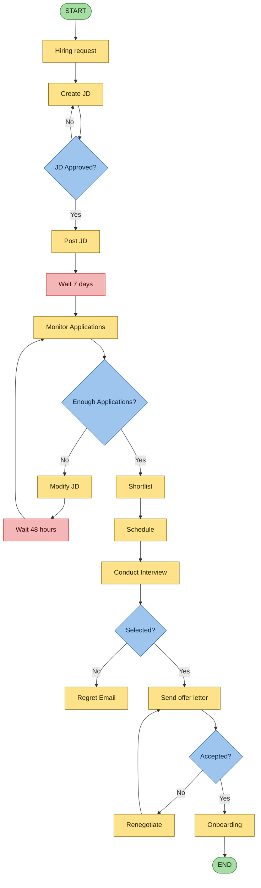
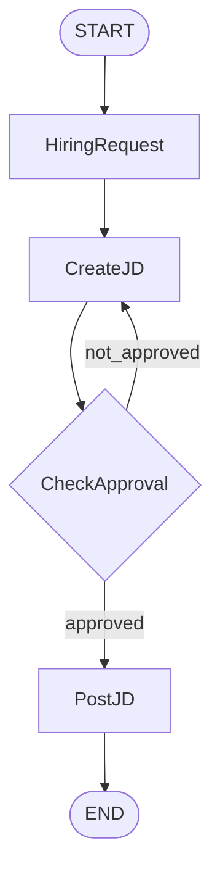

# LangChain vs LangGraph

> Markdown version of [demo.excalidraw](demo.excalidraw). Reference reading: [Building effective agents (Anthropic)](https://www.anthropic.com/engineering/building-effective-agents).

The example used throughout is a **recruitment workflow**. It has branches, loops, waiting periods and human decisions, which shows clearly where a plain LangChain chain struggles and where LangGraph helps.

---

## 1. The use case: Recruitment Process Flowchart



| Colour | Meaning |
|--------|---------|
| 🟩 Green | Start / End |
| 🟨 Yellow | Action step |
| 🟦 Blue | Decision (branch) |
| 🟥 Red | Wait (time-based pause) |

This single process already needs **conditional branches** (Approved? Enough applications? Selected? Accepted?), **loops** (Create JD ↔ Approval, Monitor ↔ Modify JD, Offer ↔ Renegotiate), **waits** (7 days, 48 hours) and **state** that grows across steps.

---

## 2. LangChain implementation

The first part of the flow only: **Hiring request → Create JD → Approve → Post JD**.

```python
hiring_prompt = "We need to hire a Software Engineer for our backend team."

# Step 2: Create JD using LLM
llm = ChatOpenAI(model="gpt-4", temperature=0)

jd_prompt = ChatPromptTemplate.from_template(
    "Create a job description based on the hiring request:\n\n{request}"
)
jd_chain = jd_prompt | llm | StrOutputParser()

# Step 3: Approval function
def approve_jd(jd: str) -> bool:
    # Simulate approval logic
    return "Approved"

# Step 4: Post JD function
def post_jd(jd: str):
    print("JD Approved and Posted:\n")
```

```python
# Step 5: Loop until JD is approved
approved = False
jd_output = None

while not approved:
    jd_output = jd_chain.invoke({"request": hiring_prompt})
    print(jd_output)

    approved = approve_jd(jd_output)

    if not approved:
        print("JD not approved. Regenerating...\n")

# Final Step
if approved:
    post_jd(jd_output)
```

> **Note:** `approve_jd` is annotated `-> bool` but returns the string `"Approved"`, which is always truthy, so the loop never repeats. That's fine for a demo; real logic would return `True`/`False`.

**What to notice:** LCEL (`jd_prompt | llm | StrOutputParser()`) handles the *single LLM step* well. But the loop, the approval branch and the state (`approved`, `jd_output`) all live in **plain Python outside the chain**. LCEL has no built-in way to express "go back to a previous step".

---

## 3. Challenges with plain LangChain

As the workflow grows to the full flowchart, these problems appear:

| # | Challenge | Why it hurts in LangChain | How LangGraph handles it |
|---|-----------|---------------------------|--------------------------|
| 1 | **Control flow complexity**: conditional branches, loops, jumps | Chains are linear (DAG). Branches/loops become hand-written `while`/`if` code around the chain | Nodes + edges, `add_conditional_edges`, edges that point back to earlier nodes |
| 2 | **Handling state** | State is scattered across local variables and passed manually between calls | One typed shared `State` that every node reads and updates |
| 3 | **Event-driven execution** | Hard to pause for "Wait 7 days" or react to an external event | Graph can stop and resume from a checkpoint when an event arrives |
| 4 | **Fault tolerance** | A crash mid-way loses progress; you restart from the beginning | Checkpointers persist state after each step, so a run resumes where it failed |
| 5 | **Human in the loop (HITL)** | Approvals require custom blocking code | `interrupt()` pauses the graph for human input, then resumes |
| 6 | **Nested workflows** | Composing big multi-step flows gets messy | A compiled graph can be a node inside another graph (subgraphs) |
| 7 | **Observability** | Custom Python loops are opaque to tracing | Every node/edge transition is traced (LangSmith) and the graph can be visualised |

---

## 4. LangGraph implementation

The same JD workflow as a graph: **HR → JD → JA → Post** (Hiring Request → Create JD → JD Approval → Post JD).



### Shared state

In LangGraph, everything the workflow knows lives in one state object. For the full recruitment process it could look like this:

```python
state = {
    "goal": "Hire a backend software engineer",
    "jd": "",  # Job description text
    "jd_approved": False,
    "jd_posted": False,
    "min_applicants": 5,
    "num_applications": 0,
    "shortlisted_candidates": {
        # "candidate_id": {"name": ..., "score": ..., "status": ...}
    },
    "interview_questions": [],
    "offer_status": {
        "sent": False,
        "accepted": False,
        "renegotiated": False
    },
    "onboarding_status": {
        "completed": False,
        "start_date": None,
        "employee_id": None
    }
}
```

### Nodes (functions that read and update state)

```python
def hiring_request(_: JDState) -> JDState:
    return {"prompt": "We need to hire a software engineer for the backend team"}

llm = ChatOpenAI(model="gpt-4", temperature=0)

def create_jd(state: JDState) -> JDState:
    prompt = state["prompt"]
    response = llm.invoke(f"Create a job description for this: {prompt}")
    return {**state, "jd": response.content}

def check_approval(state: JDState) -> JDState:
    jd_text = state["jd"]
    approved = "engineer" in jd_text.lower()  # dummy logic
    return {**state, "approved": approved}

def approval_router(state: JDState) -> Literal["approved", "not_approved"]:
    return "approved" if state["approved"] else "not_approved"

def post_jd(state: JDState) -> JDState:
    print("\n✅ Final Approved JD:\n")
    print(state["jd"])
    return state
```

### Graph (nodes + edges)

```python
graph.add_node("HiringRequest", hiring_request)
graph.add_node("CreateJD", create_jd)
graph.add_node("CheckApproval", check_approval)
graph.add_node("PostJD", post_jd)

graph.add_edge("HiringRequest", "CreateJD")
graph.add_edge("CreateJD", "CheckApproval")

graph.add_conditional_edges(
    "CheckApproval",
    approval_router,
    {
        "approved": "PostJD",
        "not_approved": "CreateJD"  # Loop back
    }
)

graph.add_edge("PostJD", END)
```

**What to notice:** the loop (`not_approved → CreateJD`) and the branch are now part of the **graph itself**, not hidden in a `while` loop, and all data flows through one `state`.

### Complete runnable version

The snippets above leave out the state definition, graph creation, entry point and compile step. Filled in:

```python
from typing import Literal, TypedDict
from langchain_openai import ChatOpenAI
from langgraph.graph import StateGraph, START, END


class JDState(TypedDict, total=False):
    prompt: str
    jd: str
    approved: bool


llm = ChatOpenAI(model="gpt-4o-mini", temperature=0)

# hiring_request, create_jd, check_approval, approval_router, post_jd as above

graph = StateGraph(JDState)

graph.add_node("HiringRequest", hiring_request)
graph.add_node("CreateJD", create_jd)
graph.add_node("CheckApproval", check_approval)
graph.add_node("PostJD", post_jd)

graph.add_edge(START, "HiringRequest")
graph.add_edge("HiringRequest", "CreateJD")
graph.add_edge("CreateJD", "CheckApproval")
graph.add_conditional_edges(
    "CheckApproval",
    approval_router,
    {"approved": "PostJD", "not_approved": "CreateJD"},
)
graph.add_edge("PostJD", END)

app = graph.compile()
result = app.invoke({})
```

---

## 5. Summary: when to use which

| | LangChain (LCEL) | LangGraph |
|---|---|---|
| Shape of the flow | Linear pipeline: `prompt \| llm \| parser` | Graph with branches, loops and jumps |
| State | Passed manually between steps | Shared, typed state object |
| Loops / retries of steps | Hand-written Python around the chain | Edges that point back to earlier nodes |
| Pause / resume, HITL | Custom code | Checkpointers + `interrupt()` |
| Best for | Single-pass tasks: summarise, extract, RAG answer | Long-running, multi-step, stateful agent workflows |

**Rule of thumb:** use LCEL for each *step*, and LangGraph to *orchestrate* the steps when the flow has decisions, loops or needs to survive failures and human pauses.
