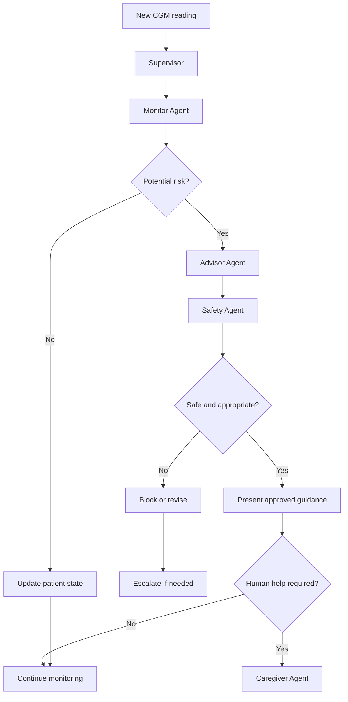
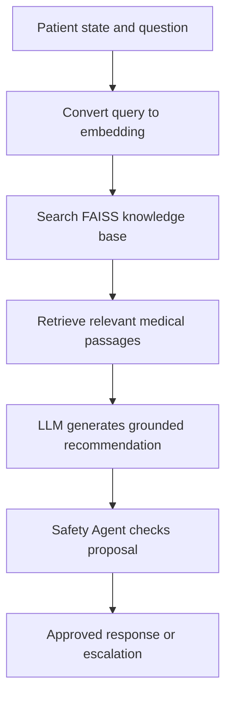
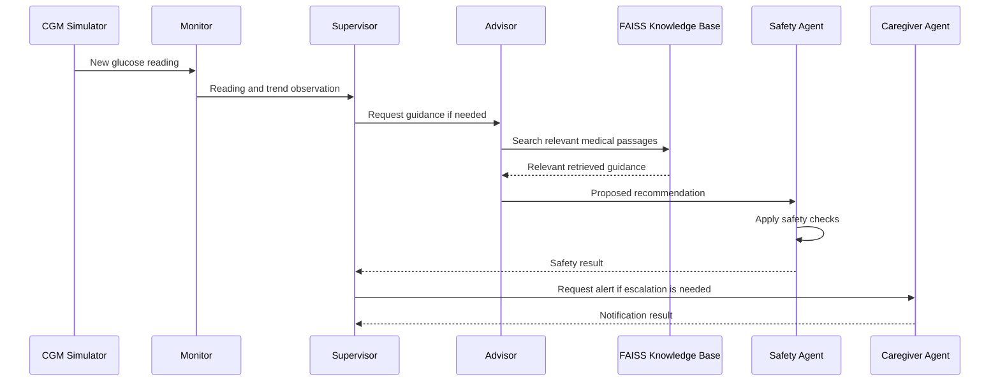

# The Guardian Angel System (GAS) — Explained in Simple English

## 1. What problem does GAS solve?

The **Guardian Angel System (GAS)** is an intelligent digital assistant designed to monitor a diabetic patient's health, identify potential problems, suggest appropriate guidance, and alert a human caregiver when necessary.

A Continuous Glucose Monitor (CGM) measures glucose approximately every five minutes—about 288 readings per day. Glucose can change because of food, insulin, exercise, sleep, illness, or stress. A doctor or family member cannot watch every reading around the clock.

GAS aims to help by monitoring readings, identifying potential risks, checking relevant context, and deciding whether to provide information or escalate an issue to a human.

### Example workflow

1. The CGM reports that glucose is dropping quickly.
2. The **Monitor Agent** detects the downward trend.
3. The **Supervisor Agent** coordinates the next steps.
4. The **Advisor Agent** retrieves relevant medical guidance.
5. The **Safety Agent** checks the proposed recommendation.
6. If necessary, the **Caregiver Agent** alerts a family member or healthcare professional.

This is an example of an **agentic AI system**.

> **Important:** GAS is an educational architecture, not a proven medical device. Real-world deployment would require clinical validation, privacy safeguards, and appropriate medical oversight. It must not independently prescribe insulin doses.

## 2. What is an AI agent?

An AI agent is a software component that can observe information, reason about a task, and perform an assigned action using available tools.

Think of a hospital team. Each member has a specific responsibility:

| Agent | Role | Responsibility |
|---|---|---|
| Supervisor | Team manager | Coordinates agents and decides which step happens next. |
| Monitor | Health observer | Watches glucose readings and identifies unusual changes. |
| Advisor | Medical information researcher | Finds relevant medical guidance and prepares a proposed recommendation. |
| Safety Critic | Safety inspector | Checks whether the proposed action violates safety rules. |
| Caregiver Notifier | Messenger | Prepares and sends alerts when human help is needed. |

The Supervisor coordinates the work; it is not necessarily the most knowledgeable agent.

## 3. The five agents in detail

### 3.1 Supervisor Agent

**Role: Team manager**

The Supervisor coordinates the workflow. It examines the current patient state and decides which agent should act next.

It may consider questions such as:

- Is there a new glucose reading?
- Has the Monitor detected a possible risk?
- Is an Advisor recommendation needed?
- Has the Safety Agent approved the recommendation?
- Should a caregiver be notified?

The book describes the Supervisor as being implemented with **LangGraph**, which lets developers connect processing steps into a graph, define conditions, and route execution to different agents.

Illustrative workflow:



This diagram is illustrative. Actual routing rules depend on the implementation and validated clinical requirements.

**In simple words:** The Supervisor decides who works next and keeps the workflow organised.

### 3.2 Monitor Agent

**Role: Health observer**

The Monitor receives information such as:

- Current glucose level.
- Previous glucose readings.
- Whether glucose is rising or falling.
- Recent meals and physical activity.
- Relevant medication records.

It looks for changes that may need attention.

Example:

| Time | Glucose reading |
|---|---:|
| 10:00 | 130 mg/dL |
| 10:05 | 115 mg/dL |
| 10:10 | 98 mg/dL |
| 10:15 | 79 mg/dL |

The Monitor identifies a downward trend. A single reading does not always tell the full story: the trend, symptoms, sensor accuracy, and patient context matter too.

Illustrative observation:

```json
{
  "glucose_mg_dl": 79,
  "trend": "falling",
  "risk_flag": "review_required"
}
```

This is an illustrative data structure, not a guaranteed schema from the book.

**In simple words:** The Monitor watches the data and reports what it observes. It does not independently decide the patient's treatment.

### 3.3 Advisor Agent

**Role: Medical information researcher**

The Advisor generates proposed recommendations using the patient's situation and relevant medical guidance. It uses **RAG (Retrieval-Augmented Generation)**.

RAG combines two steps:

1. **Retrieval:** Find relevant information from a trusted knowledge source.
2. **Generation:** Use an AI model to prepare an answer grounded in that information.

A typical process is:

1. Receive the patient's current state.
2. Search relevant medical guidance.
3. Retrieve useful passages.
4. Use an AI model to prepare a response.
5. Pass the proposed response to the Safety Agent.

The Advisor should not invent medical guidance or replace a clinician.

**In simple words:** The Advisor is like a researcher who looks up relevant medical information before suggesting what to do.

### 3.4 Safety Critic Agent

**Role: Safety inspector**

An AI-generated answer can be incorrect, incomplete, or dangerous. The Safety Agent checks the proposed action before it is delivered.

It may check:

- Does the recommendation violate a defined safety rule?
- Does it suggest an unsafe medication action?
- Is the available information sufficient?
- Does the situation require human review?
- Is the recommendation consistent with approved clinical constraints?

For example, if the Advisor proposes an insulin adjustment, the Safety Agent checks whether the system is authorised to make that recommendation and whether the proposal violates validated safety rules. If the action is prohibited, the system blocks it and follows the appropriate escalation path.

The book mentions two AI training concepts:

- **Constitutional AI:** Techniques for training or guiding an AI to follow defined principles and critique its own responses.
- **PPO (Proximal Policy Optimization):** A reinforcement-learning algorithm that updates a policy using a reward signal.

These techniques do not guarantee safety by themselves. A real medical system also needs explicit rules, testing, clinical validation, and human oversight.

**In simple words:** The Advisor proposes; the Safety Agent checks.

### 3.5 Caregiver Notifier Agent

**Role: Human communication coordinator**

Sometimes an AI system should not handle a situation alone. The Caregiver Agent prepares alerts for an appropriate recipient, such as a family caregiver, nurse, or healthcare service.

An illustrative alert might say:

> A potentially serious glucose trend has been detected. Please check the patient's current condition and follow the established care plan.

An alert may include:

- What happened.
- The latest available readings.
- Why the alert was triggered.
- What human follow-up is required.

The actual notification mechanism might be an application alert, SMS, or another configured service.

**In simple words:** When human assistance is needed, this agent communicates the alert.

## 4. The three shared services

The agents need shared tools and data to work together. GAS uses three important services.

### 4.1 FAISS Knowledge Base

**Analogy: A searchable medical reference library**

FAISS stands for **Facebook AI Similarity Search**. It helps a system find vectors (numerical representations of information) that are similar to a search query.

The book describes this setup:

- **ADA guidelines:** The source medical guidance.
- **Sentence Transformers:** Converts text into numerical vectors called *embeddings*.
- **FAISS `IndexFlatIP`:** Searches vectors using inner-product similarity.
- **NumPy or keyword search:** Alternative search methods if FAISS is unavailable.

An embedding is simply a list of numbers representing aspects of a piece of text.

For example:

- Text A: “What should happen when glucose is low?”
- Text B: “Guidance for treating hypoglycaemia.”

Their embeddings may be similar because the texts discuss related topics.

**Technical detail:** `IndexFlatIP` ranks vectors using inner product. It behaves like cosine-similarity search when the vectors are normalised appropriately.

**Key idea:** FAISS helps retrieve relevant information. It does not itself understand medicine or decide whether a recommendation is safe.

### 4.2 LangGraph State Store

**Analogy: The team's shared notebook**

Imagine the five agents each have a separate notebook. Without shared state, the Advisor might not know what the Monitor observed, and the Safety Agent might not know what the Advisor proposed.

The State Store helps maintain shared workflow information.

The book mentions:

- **`GASState`:** Represents the information carried through the workflow.
- **`MemorySaver`:** Saves workflow state using a LangGraph checkpointer.

Illustrative example:

```python
state = {
    "patient_id": "PATIENT_001",
    "glucose": 79,
    "trend": "falling",
    "recommendation": None,
    "safety_status": "pending",
    "alert_level": "review_required"
}
```

This is illustrative Python, not the repository's exact implementation.

The Supervisor and other nodes can read relevant state and update it as processing continues.

**Important distinction:** Workflow state is not the same as unlimited permanent memory. What persists, for how long, and under which patient or conversation identifier depends on the storage and configuration.

### 4.3 CGM Simulator

**Analogy: A virtual glucose sensor**

A simulator creates artificial sensor readings that resemble possible real-world situations. Developers can test the system without connecting it to a real patient.

The book describes five clinical scenarios, although the excerpt does not name them. Example test scenarios might include:

- Stable glucose.
- Glucose dropping quickly.
- Glucose rising after a meal.
- Prolonged high glucose.
- Unusual or noisy sensor readings.

These are examples of useful test cases, not a claim about the exact five scenarios implemented in the repository.

The simulator generates readings every five minutes and lets developers check how the agents respond.

**Key idea:** A simulator lets developers test the whole system safely and repeatedly before real-world deployment.

## 5. What happens inside RAG?



Suppose the patient has a glucose reading that is dropping quickly:

1. The Monitor reports the reading and its trend.
2. The Supervisor decides that medical guidance is needed.
3. The Advisor converts the relevant query into an embedding.
4. FAISS retrieves relevant passages from the knowledge base.
5. The language model uses those passages to prepare a proposed response.
6. The Safety Agent checks the proposal.
7. The system presents appropriate guidance or escalates the situation.

This is different from asking a general chatbot a question and accepting whatever it replies.

**Important:** RAG improves access to evidence; it does not guarantee that the evidence is current, relevant, or correctly interpreted. Those requirements need separate validation.

## 6. What does continuous monitoring mean?

A CGM may generate readings every five minutes, but that does not necessarily mean every agent must execute a complete AI workflow for every reading.

A practical implementation could:

- Ingest every sensor reading.
- Update the current glucose trend.
- Run inexpensive threshold and anomaly checks.
- Trigger the full multi-agent workflow when certain conditions are met.
- Save important observations and escalation events.

This can reduce unnecessary AI calls, cost, latency, and repetitive processing.

The system should also account for missing sensor readings, stale data, duplicate events, and communication failures.

## 7. Important technical terms

| Term | Simple explanation |
|---|---|
| Multi-agent AI | Multiple specialised AI components working together. |
| LangGraph | Framework for connecting agent steps, conditions, and shared state into a workflow. |
| RAG | Retrieves external information before an AI model generates an answer. |
| FAISS | Library for searching similar numerical vectors efficiently. |
| Embedding | A list of numbers representing text or other information. |
| CGM | Continuous Glucose Monitor, a device that measures glucose over time. |
| Human-in-the-loop | A human reviews, approves, or handles situations that require human judgement. |
| Safety constraints | Rules that prohibit or restrict unsafe actions. |
| Constitutional AI | Techniques for guiding models using stated principles and critiques. |
| PPO | A reinforcement-learning algorithm for improving a policy using reward signals. |
| State store | Shared workflow information that agents can access. |
| Checkpointer | Mechanism that saves workflow state so execution can resume or continue. |
| Supervisor graph | Workflow that determines which agent or step runs next. |
| LLM | Large Language Model: an AI model trained to understand and generate language. |
| MCP | Model Context Protocol, a standard for connecting AI applications to external tools and data sources. |

## 8. Why does the chapter mention the original Guardian Angel vision from 1994?

The book connects modern AI technology to an older research vision from MIT.

In 1994, researchers described a patient-centred digital assistant that could:

- Maintain a long-term understanding of a patient's medical information.
- Monitor health continuously.
- Help reason about potential risks.
- Respect the patient's informed consent.
- Coordinate care across healthcare providers.

At that time, the technology needed to build such a system was much more limited. Modern language models, retrieval systems, workflow frameworks, and sensor integrations make it more practical to prototype parts of this vision.

The book presents GAS as a modern implementation inspired by that earlier idea.

The central philosophy is that the system should support the patient over time, rather than answer only one question at a time.

## 9. How GAS connects to agentic AI concepts

| Concept | How GAS uses it |
|---|---|
| Multi-agent architecture | Five specialised agents divide the work rather than relying on one general-purpose agent. |
| RAG | The Advisor retrieves relevant medical documents before generating its response. |
| Workflow orchestration | LangGraph coordinates steps, decisions, and conditional paths. |
| AI safety and guardrails | The Safety Agent checks proposed actions against hard constraints. |
| Memory and state management | The State Store maintains information needed across workflow steps. |
| Evaluation and testing | The CGM simulator lets developers test different scenarios and measure behaviour. |
| Reinforcement learning | The chapter mentions PPO as part of the broader system's safety-training discussion. |
| MCP | Can connect AI applications to external tools and data sources; it is not one of the three shared services explicitly listed in this chapter. |

The excerpt mentions reinforcement learning, PPO, and MCP, but it does not provide enough detail to explain the complete training pipeline or MCP implementation.

## 10. The entire system in one example



This is a simplified sequence. Actual routing depends on the implementation; for example, a critical event may need immediate escalation rather than waiting for a full RAG response.

The overall logic is:

1. **Observe:** Collect the glucose reading.
2. **Detect:** Identify unusual readings or trends.
3. **Coordinate:** Decide which processing steps are needed.
4. **Research:** Retrieve relevant medical guidance.
5. **Validate:** Check the proposed action against safety requirements.
6. **Escalate:** Involve a human when necessary.
7. **Remember:** Update workflow state and continue monitoring.

## 11. How to practise this project

The chapter describes this companion repository:

[The Hitchhiker’s Guide to Agentic AI — GitHub repository](https://github.com/haggair/agentic-ai-book)

A sensible learning order is:

1. Understand the `GASState` data structure and the information passed between agents.
2. Run the CGM simulator and inspect its generated readings.
3. Implement or study the Monitor's trend detection.
4. Explore the FAISS knowledge base and understand embeddings and similarity search.
5. Trace the Advisor's RAG pipeline from query to retrieved passages to generated answer.
6. Study the LangGraph Supervisor, its conditional edges, and the shared state.
7. Examine the Safety Agent and test unsafe, incomplete, and uncertain recommendations.
8. Test the Caregiver escalation path, then evaluate the full system across different scenarios.

The chapter mentions `capstone_gas/gas_system.py` for the knowledge base and `shared/patient_data.py` for the simulator. Those are useful starting points for exploring the code.

## Final takeaway

Remember GAS using this simple analogy:

- **Monitor:** Watches.
- **Supervisor:** Coordinates.
- **Advisor:** Researches and proposes.
- **Safety Critic:** Checks.
- **Caregiver Notifier:** Alerts humans.
- **FAISS:** Finds relevant medical knowledge.
- **LangGraph State Store:** Maintains shared workflow information.
- **CGM Simulator:** Generates test data.

The biggest lesson is not just how to create five AI agents. It is how to **combine AI reasoning, external knowledge, shared state, workflow control, explicit safety rules, and human oversight into one system**.

That is what makes the Guardian Angel System a useful example for learning agentic AI engineering.
